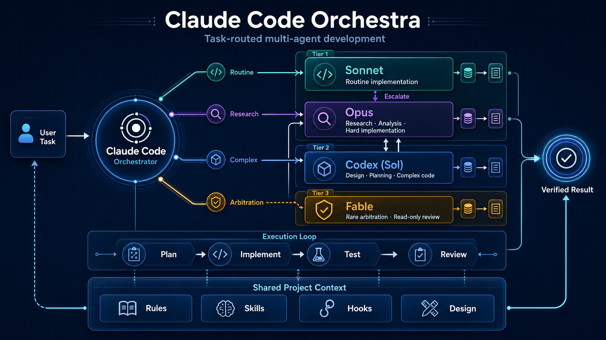

# claude-code-orchestra (Claude Code-only edition)



Multi-Agent AI Development Environment — **Claude Code-only edition** (`claude-only` branch)

```
Claude Code (Orchestrator) ─┬─ Sonnet Subagents (Routine Implementation)
                             ├─ Opus Subagents (Planning, Design, Review, Research, Difficult Implementation)
                             ├─ debugger (Root-Cause Analysis, Opus)
                             └─ fable-advisor (Rare Escalation)
```

This branch is a separately maintained flavour of the template in which every
agent is Claude: the main agent is Claude Code and every subagent is invoked
through Claude Code's native Agent tool. No other AI CLI is required, installed,
or called. The multi-CLI flavour lives on `main`.

## Quick Start

Confirm that Claude Code is installed and authenticated first:

```bash
claude --version
```

### New Project

Create a repository from this template's `claude-only` branch (GitHub's **Use
this template** button with *Include all branches*, then make `claude-only` the
default branch), clone it, then run:

```bash
claude
```

Run `/init` inside Claude Code to detect the project stack and populate the project
identity and design document.

### Existing Project

Run this from the root of an existing Git repository:

```bash
template_dir="$(mktemp -d)"
git clone --depth 1 --branch claude-only https://github.com/DeL-TaiseiOzaki/claude-code-orchestra.git "$template_dir"
bash "$template_dir/scripts/install.sh" . && rm -rf "$template_dir"
```

The installer preserves project-owned files, including `README.md`, `VERSION`, and
existing `AGENTS.md` / `CLAUDE.md` content. It installs the merged content in
`.claude/STATE.md` and installs the root `AGENTS.md` contract. An existing
`CLAUDE.md` is moved aside to `CLAUDE.md.pre-agents-md.bak`, because Claude Code
reads `AGENTS.md` only when no `CLAUDE.md` shadows it. Template-owned path
conflicts stop the install before changes are made. After reviewing the reported
paths, `--force` can be used to back them up under `.orchestra-backup-*/` and
replace them.

An existing `.claude/settings.json` is never overwritten. When a manual merge is
needed, the installer writes `.claude/settings.orchestra.json`; merge the required
settings and delete the candidate before starting Claude Code.

Then start Claude Code and run `/init` inside it:

```bash
claude
```

## Prerequisites

### Claude Code

```bash
npm install -g @anthropic-ai/claude-code
claude login
```

### System Tools

The installer and updater require `git` and standard Unix shell tools. Template
updates additionally require `rsync`.

### Keeping Claude Code Up to Date

Claude Code releases frequently — model names, flags, and hook semantics drift
between minor versions. **Update before each working session.**

```bash
claude update
claude --version
```

Subagent model routing is explicit in `.claude/agents/`: every agent pins its
model alias in frontmatter (`general-purpose-sonnet` → `sonnet`;
`general-purpose-opus` and `debugger` → `opus`). Unspecified subagents default
to Sonnet through `.claude/settings.json` (`env.CLAUDE_CODE_SUBAGENT_MODEL`).
`scripts/check.sh` verifies that every agent pins a Claude model.

## Architecture

The normative orchestration policy, the complete agent/skill overview, and the
completion-verification guardrails all live in root `AGENTS.md`;
`.claude/rules/tiers.md` carries the stable tier details. The diagram below is a
non-normative overview.

```
┌─────────────────────────────────────────────────────────────┐
│       Claude Code (Orchestrator — Opus, 1M context)         │
│       → Context conservation is top priority                │
│       → Handles user interaction, coordination, concise edits│
│                          │                                  │
│  ┌───────────────────────┼──────────────────────────────┐   │
│  │  Tier 1 — Default     │                              │   │
│  │  ┌────────────────────┴─────────────────────────┐    │   │
│  │  │ general-purpose-sonnet: routine impl.        │    │   │
│  │  └──────────────────────────────────────────────┘    │   │
│  │                       │                              │   │
│  │  ┌────────────────────┴─────────────────────────┐    │   │
│  │  │ Tier 2 — Deep  (Claude Opus)                 │    │   │
│  │  │ general-purpose-opus: design, planning,      │    │   │
│  │  │   review, research, difficult impl.          │    │   │
│  │  │ debugger: root-cause analysis                │    │   │
│  │  │ built-in Plan agent: read-only plans         │    │   │
│  │  └──────────────────────────────────────────────┘    │   │
│  │                       │                              │   │
│  │  ┌────────────────────┴─────────────────────────┐    │   │
│  │  │ Tier 3 — Fable  (rare escalation authority)  │    │   │
│  │  │ → Arbitration, stuck problems, final review  │    │   │
│  │  │ → May land the resolution; notes to reviews/ │    │   │
│  │  └──────────────────────────────────────────────┘    │   │
│  └──────────────────────────────────────────────────────┘   │
└─────────────────────────────────────────────────────────────┘
```

### Context Management (Important)

Use the routing policy and execution patterns in `AGENTS.md`.
Delegation mechanics remain in `.claude/rules/` and the corresponding canonical
agent or skill definitions.

The posture is **delegation-first**: `.claude/rules/delegation.md` makes direct
execution by the main agent the exception, limited to a closed Self-Handle List,
and names the triggers (including the deep-reasoning triggers that route work to
Tier 2), route table, and subagent prompt contract that every skill follows.
Delegating moves the work, not the accountability — the caller still runs the
acceptance checks and inspects the diff.

## Directory Structure

`.claude/` is the one physical runtime: rules, skills, agent definitions, hooks,
project documents, and state. There are no peer-CLI adapter directories.
Nothing in the layout is reached through a symlink.

```
.
├── AGENTS.md                    # Single root contract, auto-loaded by Claude Code: mission, routing, catalogs, gates, guardrails
├── README.md
├── PROGRESS.md                  # Generated by the first /checkpointing run; latest 5 summaries
├── LICENSE
├── pyproject.toml               # Python project configuration
├── uv.lock                      # Dependency lock file
├── VERSION                      # Version of this template repository; downstream projects may replace it
│
├── .claude/                     # Runtime (physical source)
│   ├── settings.json            # Claude Code settings; hooks point to .claude/hooks/
│   ├── orchestra-version        # Installed Orchestra version in downstream projects
│   ├── STATE.md                 # Main agent, repository identity, and working state
│   ├── agents/                  # Subagent definitions, auto-discovered by Claude Code
│   ├── skills/                  # Workflow skills and deterministic helpers
│   │   └── _shared/             # Bundled runtime: helpers every skill may depend on
│   ├── hooks/                   # Hook implementations
│   ├── rules/                   # Policy: delegation, tiers, coding, testing, security, state
│   ├── docs/                    # INDEX.md registry, design, research, reviews
│   ├── logs/                    # Runtime logs (git-ignored)
│   └── checkpoints/             # Session checkpoints (git-ignored)
│
├── tests/                      # Contract tests for the template's own scripts and docs
│
└── scripts/
    ├── check.sh                # Contract, bootstrap, model, and tier coherence checker
    ├── install.sh              # Conflict-aware installer for existing projects
    └── update.sh               # Template update script (tracks the claude-only branch)
```

Claude Code auto-loads root `AGENTS.md`, which is self-contained: response
structure, handoff rules, and the completion-verification guardrails are all in
the file that gets loaded. No `CLAUDE.md` exists: Claude Code loads `AGENTS.md`
only when none is found.

### Verifying Subagent Work

- Subagents are called only through Claude Code's native Agent tool; planning,
  design, and review delegations are read-only by instruction.
- A subagent's completion report is never trusted on its own. Bracket a
  delegation with `.claude/skills/_shared/edit_provenance.py` (`--snapshot`
  before, `--compare` after) to name exactly the files it touched, then run
  `.claude/skills/_shared/verify_delegation.py` for deletions, placeholders,
  weakened tests, and out-of-scope edits (root `AGENTS.md`, "Guardrails").

## Workflow

The main workflow executes two skills in sequence.

```
/feature <feature>   Planning: mode determination → understanding → research & design → plan
    ↓ After user approval (COMPLEX route)
/team-execute        Phase 1: Parallel implementation → Phase 2: Parallel review (Agent Teams)
```

1. **Mode determination**: existing (Opus-consulted design) or greenfield (Agent Teams research & design)
2. **Opus subagent** analyzes the codebase (1M context) + **Claude** conducts requirements gathering with the user
3. Existing mode: **`general-purpose-opus` consults** design, plan, and validate. Greenfield mode: **Agent Teams** — Researcher and Architect work in parallel
4. **Claude** integrates research and design, then presents the plan to the user
5. After approval, `/team-execute` runs parallel implementation by module, then parallel review for security, quality, and testing (`--review-only` skips implementation)

## Skills

Each skill is a `SKILL.md` procedure that an agent follows. Steps with exactly
one correct output for a given input — deriving artifact paths, validating
document structure, capturing reproductions, running quality gates — are
delegated to bundled scripts instead of being described in prose, so they cannot
drift between phases or fail silently. Judgment steps stay in markdown. The
boundary and the shared script contract (one JSON object on stdout, a common
exit-code vocabulary, errors never swallowed) are documented in
`.claude/skills/_shared/README.md`.

### Core Workflow

#### `/feature` — Feature Planning & Implementation (unified)

One entry point for feature work, with two modes (merger of the old `/add-feature` and `/start-feature`).

```
/feature user profile editing feature
```

**Modes:**
- **existing** (formerly `/add-feature`) — Opus-first addition to an established codebase: Opus subagent scan + Opus scope & impact analysis, then Opus architecture design, implementation plan, and an independent validation
- **greenfield** (formerly `/start-feature`) — large/new feature requiring external research: Opus subagent codebase analysis, then Agent Teams (Researcher + Architect) perform parallel research & design

**Shared complexity-based routing:**
- SIMPLE (1-3 files, <50 LOC) → One implementation subagent (`general-purpose-sonnet`, or `general-purpose-opus` for risky changes)
- MODERATE (3-5 files) → Implementation subagent + `/team-execute --review-only`
- COMPLEX (5+ files) → `/team-execute`

#### `/team-execute` — Parallel Implementation + Review (unified)

Two-phase Agent Teams execution (merger of the old `/team-implement` and `/team-review`). Executes based on the plan approved in `/feature`.

```
/team-execute                 # Phase 1 IMPLEMENT → Phase 2 REVIEW
/team-execute --review-only   # Skip Phase 1; review existing changes
```

**Phase 1 IMPLEMENT:**
- Launches Teammates per module/layer with separated file ownership
- Manages dependencies via shared task list for autonomous coordination
- Each Teammate records a work log to `.claude/logs/agent-teams/` upon completion

**Phase 2 REVIEW (reviewer composition):**
- **Security Reviewer** — Detects security vulnerabilities
- **Quality Reviewer** — Checks code quality & pattern compliance (with an explicit deep-logic pass)
- **Test Reviewer** — Validates test coverage & quality

#### `/spike` — Technical Investigation & Feasibility Study

A deep-reasoning-first, time-boxed technical investigation. Produces a **decision document** (with go/no-go recommendation). Provides decision-making material, not an implementation plan.

```
/spike Should we adopt WebSocket or SSE?
```

**Workflow:**
1. **Claude + Opus consult** → Frame investigation questions & define constraints
2. **Agent Teams** → Researcher (external research) and Feasibility Analyst (structured feasibility analysis) investigate in parallel
3. **Fresh Opus subagent** → Synthesize into go/no-go recommendation & produce research report

> After a GO decision, proceed to implementation with `/feature`

### Development

#### `/plan` — Implementation Plan

Breaks down requirements into concrete steps.

```
/plan Add API endpoint
```

**Output:**
- Implementation steps (files, changes, verification methods)
- Dependencies & risks
- Validation criteria

#### `/tdd` — Test-Driven Development

Implements using the Red-Green-Refactor cycle.

```
/tdd user registration feature
```

**Workflow:**
1. Design test cases
2. Write failing tests (Red)
3. Minimal implementation (Green)
4. Refactoring (Refactor)

#### `/simplify` — Code Refactoring

Simplifies code and improves readability.

#### `/troubleshoot` — Error Diagnosis & Fix Planning

Diagnoses errors and creates fix plans through multi-agent coordination centered on the `debugger` subagent and structured analysis protocols.

```
/troubleshoot TypeError: cannot unpack non-iterable NoneType object
```

**Workflow:**
1. **Opus subagent + `debugger`** → Error reproduction, context collection & initial hypotheses
2. **Agent Teams** → Root Cause Analyst and Impact Investigator diagnose in parallel
3. **Claude + fresh Opus validator** → Fix plan integration & user approval

### Agent Delegation

Design decisions, planning, code review, and trade-off analysis go to the
`general-purpose-opus` subagent; errors with an unproven root cause go to the
`debugger` subagent. The `agent-router.py` hook suggests the route.

**Trigger examples:**
- "How should this be designed?" "How should I implement this?" → `general-purpose-opus`
- "Why isn't this working?" "I'm getting an error" → `debugger`
- "Which is better?" "Compare these options" → `general-purpose-opus`

### Documentation

#### `/design-tracker` — Design Decision Tracking

Detects design decisions during conversation and structurally updates the relevant section of `.claude/docs/DESIGN.md` (機能要件 / 非機能要件 / アーキテクチャ / 技術選定 / 制約 / Key Decisions). Activates proactively and also on explicit requests ("record this", "update DESIGN").

#### `/research-lib` — Library Research

Investigates a library and generates comprehensive documentation in `.claude/docs/libraries/`.

```
/research-lib httpx
```

#### `/update-lib-docs` — Update Library Documentation

Updates existing documentation in `.claude/docs/libraries/` with the latest information.

### Session Management

#### `/checkpointing` — Session Persistence

Records session activity into `.claude/checkpoints/`, regenerates the rolling
`PROGRESS.md`, and compacts stale working blocks in `.claude/STATE.md` while
preserving the main-agent selection, repository identity, and progress link.

```bash
/checkpointing                    # Full recording + pattern discovery
/checkpointing --since "2026-02-08"  # Only since a specific date
/checkpointing --compact-only    # Run only the Compact Phase (old /context-refresh)
```

#### `/init` — Project Initialization

Analyzes the project structure, auto-detects tech stack, commands, and
configuration. Populates `.claude/docs/DESIGN.md` and updates only the thin
`## Repository Identity` section in `.claude/STATE.md`.

#### `/catchup` — Onboarding Guide

Scans the repository (git history, AGENTS.md, project rules, skill catalog, DESIGN.md, research & library notes, checkpoints, agent-team logs) and writes a `GUIDE.md` at the repository root so new or returning contributors can understand past work and resume quickly.

```bash
/catchup
```

## Development

### Template Update

Safely applies template updates to your local project.

```bash
# Update to the latest claude-only version (the updater's default ref)
./scripts/update.sh

# Update to a specific version
./scripts/update.sh v0.2.0

# Skip confirmation prompt
./scripts/update.sh --yes
```

When upgrading an installation that still uses an updater from v0.3.0 or earlier,
replace the updater itself before the first run. This prevents the old process from
writing its template version to a project-owned root `VERSION`:

```bash
template_dir="$(mktemp -d)"
git clone --depth 1 --branch claude-only https://github.com/DeL-TaiseiOzaki/claude-code-orchestra.git "$template_dir"
cp "$template_dir/scripts/install.sh" "$template_dir/scripts/update.sh" scripts/
chmod +x scripts/install.sh scripts/update.sh
rm -rf "$template_dir"
./scripts/update.sh
```

**How it works:**
- `AGENTS.md` (the root contract) is replaced with the template version. A
  pre-2.0 `CLAUDE.md` symlink is removed, and a real `CLAUDE.md` is moved to
  `CLAUDE.md.pre-agents-md.bak` so it cannot shadow `AGENTS.md`.
- `.claude/STATE.md`, project design/research, logs, and checkpoints are
  preserved. Legacy 2/3-zone `AGENTS.md` or `CLAUDE.md` state is migrated into
  `.claude/STATE.md` before the bootstrap is replaced.
- Only template-owned runtime subdirectories are atomically synced. Legacy
  runtime paths under `.agents/` are removed, and so are the peer-CLI adapter
  files the multi-CLI flavour installed (a project's own CLI configuration is
  left untouched).
- The updater tracks the `claude-only` branch by default; pass a ref, or set
  `ORCHESTRA_TEMPLATE_REF`, to update from somewhere else.
- Real legacy `.agents/{docs,logs,checkpoints}` data and `.agents/STATE.md` are
  moved to `.claude/`; collisions are backed up before missing files are merged.
- Known legacy `.agents/hooks/` and `.agents/logs/` references in Claude
  settings are migrated to `.claude/`; other settings differences still require
  manual review.
- `.claude/settings.json` is never overwritten; it only shows a diff (manual merge required)
- The installed template version is stored in `.claude/orchestra-version`; a downstream project's root `VERSION` is never modified
- If the update modifies `scripts/update.sh` itself (e.g. a new version adds
  template directories such as `.claude/rules/`), **run `./scripts/update.sh` a second
  time** — the first run still uses the old script's sync list. Newer scripts
  print a reminder when this applies (updating from v0.2.0 does not, so run
  twice when upgrading to v0.3.0)

### Tech Stack

| Tool | Purpose |
|--------|------|
| **uv** | Package management (pip is prohibited) |
| **ruff** | Linting & formatting |
| **ty** | Type checking |
| **pytest** | Testing |
| **poethepoet** | Task runner |

### Commands

```bash
# Dependencies
uv add <package>           # Add package
uv add --dev <package>     # Add dev dependency
uv sync                    # Sync dependencies

# Quality checks
poe lint                   # ruff check + format
poe typecheck              # ty
poe test                   # pytest
poe all                    # Run all checks

# Direct execution
uv run pytest -v
uv run ruff check .
```

## Hooks

Automation hooks execute agent coordination and quality checks at the appropriate timing.

| Hook | Trigger | Action |
|--------|----------|------|
| `agent-router.py` | User input | Suggests routing to `general-purpose-opus` / `debugger` / `fable-advisor` |
| `lint-on-save.py` | File save | Auto-runs lint |
| `check-design-before-write.py` | Before file write | Suggests a `general-purpose-opus` design review for structural changes |
| `check-plan-after-task.py` | After a subagent (Task/Agent) completes | Suggests independent validation of planning/design results |
| `post-bash-check.py` | Any Bash tool call | Dispatcher: runs error detection and test-failure analysis in one process (deduped) |
| `error-to-debugger.py` | Bash error detected | Suggests the `debugger` subagent (invoked in-process by `post-bash-check.py`) |
| `post-test-analysis.py` | Test/build failure | Suggests root-cause analysis via the `debugger` subagent (invoked in-process by `post-bash-check.py`) |
| `post-implementation-review.py` | After large implementation | Suggests a `general-purpose-opus` code review |

## Language Rules

- **Code, thinking, and reasoning**: English
- **Responses to users**: Japanese
- **Technical documentation**: English
- **README, etc.**: Japanese permitted

Normative definitions: `AGENTS.md` `## Language Protocol` for which language
goes where, `.claude/rules/language.md` `## Response Style` for how the
user-facing reply reads and how long it runs.
